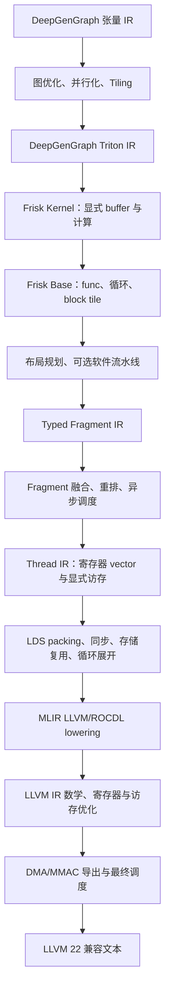

# DeepGenGraph 当前 Pass 总结

整理日期：2026-11-06。源码快照：`8f282c10`，以当前工作区实现、CMake 编译列表和调用入口为依据。

本文覆盖当前目录中的自定义 MLIR pass、主要标准 MLIR pass，以及 LLVM IR 导出阶段的优化。后端顺序以 [test/test_src.cpp](test/test_src.cpp) 中的 `readDeepgenGraphIRAndConvertToFriskPipeline` 为准；前端顺序参考 [python/deepgengraph/transform/common.py](python/deepgengraph/transform/common.py)。

“默认启用”表示驱动默认安排执行，是否产生改写仍取决于输入和合法性检查。表中 pass 参数名用于识别 pass，不表示 `MyTest` 支持直接传入同名命令行参数；`MyTest` 有自己的位置参数和命名选项。

## 1. 总体流程



当前主线有三个要点：

1. `MyTest` 完整执行到 LLVM IR 输出。线程合法化和 LLVM lowering 所在代码块当前为 `#if 1`。
2. 默认走 `convert-friskbase-to-fragment → convert-fragment-to-thread`，在寄存器向量物化之前保留带布局信息的 fragment，便于融合与调度。
3. 共享内存物理分配推迟到 fragment 优化之后。先规划布局和访问顺序，再计算生命周期与复用地址。

## 2. 前端：图优化与分块

主要声明位于 [Deepgengraph/Transforms/Passes.td](include/deepgengraph/Dialect/Deepgengraph/Transforms/Passes.td)，实现位于 [lib/Dialect/Deepgengraph/Transforms](lib/Dialect/Deepgengraph/Transforms)。

| Pass 参数名 | 作用域 | 主要作用 | 实现文件 |
| --- | --- | --- | --- |
| `deepgengraph-simplify` | FunctionOpInterface | 清理冗余算子、折叠可简化表达式 | `Simplify.cpp` |
| `deepgengraph-lower-complex-reduce` | FunctionOpInterface | 将复杂归约拆为更基础的计算与归约 | `LowerComplexReduce.cpp` |
| `deepgengraph-erase-type-in-kernel` | Deepgengraph Kernel | 暂存原始浮点类型，并统一中间浮点类型，方便图变换 | `EraseTypeInKernel.cpp` |
| `deepgengraph-recover-type-in-kernel` | Deepgengraph Kernel | 根据记录恢复类型 | `RecoverTypeInKernel.cpp` |
| `deepgengraph-replace-exp-and-log` | Deepgengraph Kernel | 将自然底 exp/log 改写为以 2 为底的计算及常数缩放 | `ReplaceExpAndLog.cpp` |
| `deepgengraph-equivalent-transform` | Deepgengraph Kernel | 代数重写、算子次序调整与融合 | `EquivalentTransform.cpp` |
| `deepgengraph-to-mask` | Deepgengraph Kernel | 将支持的三角截断转换为 mask 表示 | `ToMask.cpp` |
| `deepgengraph-annotate-parallelism` | Deepgengraph Kernel | 分析并标注张量维度的并行性 | `AnnotateParallelism.cpp` |
| `deepgengraph-parallelize` | Deepgengraph Kernel | 根据并行性构造并行循环；`partition` 默认 true | `Parallelize.cpp` |
| `deepgengraph-tiling` | Deepgengraph Kernel | 对 Dot 等计算分块，并融合相关生产者和消费者 | `Tiling.cpp` |
| `deepgengraph-dynamic-for` | Deepgengraph Kernel | 将适用的块循环改为动态循环，并利用 mask 提前结束循环 | `DynamicFor.cpp` |
| `deepgengraph-broadcast-transform` | Module | 调整 Dot 与广播乘除之间的计算关系 | `BroadcastTransform.cpp` |
| `deepgengraph-permute-hoisting` | Module | 调整、提升 permute | `PermuteHoisting.cpp` |
| `deepgengraph-mul-scalar-hoisting` | Module | 调整、提升标量乘法 | `MulScalarHoisting.cpp` |
| `deepgengraph-user-replicate` | Module | 复制多使用者相关计算，为后续融合整理使用关系 | `UserReplicate.cpp` |

其他前端与转换路径：

| Pass 参数名 | 主要作用 | 实现 |
| --- | --- | --- |
| `convert-deepgengraph-to-deepgengraphtriton` | 将图级并行、块操作变为 device kernel、block pointer/load/store 与 SCF 循环 | [DeepgengraphToDeepgengraphTritonPass.cpp](lib/Conversion/DeepgengraphToDeepgengraphTriton/DeepgengraphToDeepgengraphTritonPass.cpp) |
| `deepgengraphtriton-squeeze-block` | 消除 block 表示中可去掉的单位维度 | [SqueezeBlock.cpp](lib/Dialect/DeepgengraphTriton/Transforms/SqueezeBlock.cpp) |
| `deepgengraphtriton-user-replicate` | Triton 层的使用关系整理与复制 | [UserReplicate.cpp](lib/Dialect/DeepgengraphTriton/Transforms/UserReplicate.cpp) |
| `convert-deepgengraph-to-linalg-on-tensor` | 转换到 Linalg/Tensor，属于另一条 lowering 路径 | [DeepgengraphToLinalgOnTensorPass.cpp](lib/Conversion/DeepgengraphToLinalgOnTensor/DeepgengraphToLinalgOnTensorPass.cpp) |
| `deepgengraph-convert-to-tilelang` | 转换到项目的 Tilelang dialect | [DeepgengraphToTilelang.cpp](lib/Dialect/TL/Transforms/DeepgengraphToTilelang.cpp) |

`common.py::optimize` 中的主要添加顺序如下，期间多次插入 simplify/CSE：

```text
simplify → erase-type → replace-exp-and-log → equivalent-transform
→ to-mask → parallelize → equivalent-transform → tiling → dynamic-for
→ recover-type → convert-to-deepgengraphtriton → squeeze-block
```

该 Python 函数在同一个 PassManager 上多次 `run`，未在各次运行之间清空，所以前面已加入的 pass 会再次运行；上面表示添加顺序。前端表中其他 pass 并非全部被这个函数调用。Python 绑定见 [ffi/passes.cpp](ffi/passes.cpp)。

## 3. DeepGenGraph/Triton → Frisk Base

以下为 `MyTest` 的主要执行顺序。除明确列出的可选项外，驱动默认安排执行。

| 顺序 | Pass / 工厂入口 | 作用 | 源码 |
| --- | --- | --- | --- |
| 1 | `frisk::createDeepgenGraphSimplifyPass` | 内联 device kernel，整理返回值为输出参数，简化指针与 kernel 表示 | [DeepgengraphSimplify.cpp](lib/Dialect/Frisk/Transforms/DeepgengraphSimplify.cpp) |
| 2 | `createAddKernelargPermuteInfoPass` / `add-kernel-arg-info` | 记录 kernel 参数的 permute 信息 | 同上 |
| 3 | `createConvertScfForOpPass` | 将可处理的 `scf.for` 改为 `affine.for` | [DeepgengraphToFrisk.cpp](lib/Dialect/Frisk/Transforms/DeepgengraphToFrisk.cpp) |
| 4 | `createMemspaceAnalyzePass` / `add-memspace` | 推导、标注张量所在存储空间，为 buffer 化提供依据 | [DgMemspaceAnalyze.cpp](lib/Dialect/Frisk/Transforms/DgMemspaceAnalyze.cpp) |
| 5 | `kernelop-convert-to-frisk` | 将 Deepgengraph Kernel 转为 Frisk Kernel，整理参数和并行结构 | [DeepgengraphToFrisk.cpp](lib/Dialect/Frisk/Transforms/DeepgengraphToFrisk.cpp) |
| 6 | `dg-convert-to-frisk` | 将内存、计算算子转换为 Frisk 的 copy、gemm、block、reduce 等 | 同上 |
| 7 | `reconcile-unrealized-casts` | 清理转换期间的临时类型桥接 | 标准 MLIR pass |
| 8 | `createFriskFuseBlockOpsPass` | 根据 buffer 数据流融合相连 block，消除中间读写 | [FriskCanonicalize.cpp](lib/Dialect/Frisk/Transforms/FriskCanonicalize.cpp) |
| 9 | `convert-frisk-to-base` | 将 Frisk Kernel/parallel/block/for 等降低为 func、显式循环和 block tile 操作 | [FriskToBasePass.cpp](lib/Conversion/FriskToBase/FriskToBasePass.cpp) |
| 10 | `frisk-tile-attention` | 独立切 QK 归约轴和 V/O 输出列，将切片推到加载与暂存分配，保持共享 softmax | [TileAttention.cpp](lib/Conversion/FriskToBase/TileAttention.cpp) |
| 11 | `frisk-op-fuse` | 将独立乘积与后续加法融合到 GEMM 累加器；浮点重结合由 math!=strict 授权 | [FriskOpFuse.cpp](lib/Dialect/Frisk/Transforms/FriskOpFuse.cpp) |
| 12 | `frisk-reorder-workgroups`，可选 | 重排 query/head workgroup 编号；支持分组、反向 query、尾组 | [ReorderWorkgroups.cpp](lib/Conversion/FriskToBase/ReorderWorkgroups.cpp) |
| 13 | `normalize-attention-k-layout` | 对特定 attention ABI 将 K 从 BHDS 改为 BHSD，内部保留零拷贝转置视图 | [NormalizeAttentionKLayout.cpp](lib/Conversion/FriskToBase/NormalizeAttentionKLayout.cpp) |

当前 attention 从生成时就共享 QK/softmax，保留 full-D O；已删除旧 tensor unroll-and-jam Pass 及其 carrier 预算。MyTest 的位置参数在 layout 后直接接 math，再接 threads/waves；QK/VO 在 Frisk Base 层独立分块。

`normalize-attention-k-layout` 当前专用于四参数 `Attn_p2` 模式：Q 为参数 0、O 为参数 3，K 从参数 1/2 中识别。它改变外部存储约定，调用方需要提供 BHSD 的 K；当 S 与 D 相等、不能靠 shape 区分时，需要显式指定 `key-arg`。它不是任意函数的通用转置优化。

## 4. Frisk Base：异步搬运、流水线与布局规划

声明见 [FriskToBase/Passes.td](include/deepgengraph/Conversion/FriskToBase/Passes.td) 和 [Pipeline/Passes.td](include/deepgengraph/Pipeline/Passes.td)。以下大多作用于 `func.func`。

| Pass | 主要作用 | 当前触发方式 / 约束 | 源码 |
| --- | --- | --- | --- |
| `frisk-promote-gm-to-shm-async` | 把 GM→LDS copy 拆成 issue 与 wait，显式表示完成依赖 | `FRISK_GM_TO_SHM_MODE` 非 `legacy` 时调用；初始 wait 紧跟 issue | [PromoteGlobalToSharedAsync.cpp](lib/Conversion/FriskToBase/PromoteGlobalToSharedAsync.cpp) |
| `frisk-auto-pipeline` | 对可证明安全的整 tile 搬运生成 N 槽轮转、序言预取与稳态预取 | pass 始终调用，但只处理 `frisk.pipeline_hint` 标记的循环 | [AutoPipeline.cpp](lib/Pipeline/AutoPipeline.cpp) |
| `frisk-promote-gemm-matrix-loads` | 显式选择 shared→register 的 collective matrix read | 主线调用；WMMA 布局选择需与后续 tiling 一致 | [FriskBaseToTheadlevelIR_plan2.cpp](lib/Conversion/FriskToBase/FriskBaseToTheadlevelIR_plan2.cpp) |
| `frisk-pipeline-schedule` | 根据 `pipeline.stage/order` 重写为 prologue/steady/epilogue | `MyTest` 手动流水开关为 1 时调用 | [PipelineSchedule.cpp](lib/Pipeline/PipelineSchedule.cpp) |
| `frisk-lower-async-to-sync` | 将显式异步表示退回普通 copy 与同步 | copy mode 为 `sync` 时调用 | [PromoteGlobalToSharedAsync.cpp](lib/Conversion/FriskToBase/PromoteGlobalToSharedAsync.cpp) |
| `plan-wmma-layout-conversions` | 请求连续 WMMA C 布局，分析可用 XOR shuffle 完成的转换并记录 shuffle plan | 有独立 pass；主线 tiling 内部也调用规划函数 | [WmmaLayoutConversion.cpp](lib/Conversion/FriskToBase/WmmaLayoutConversion.cpp) |
| `frisk-sink-wait-buffer-ready` | 越过独立计算，将 wait 推迟到依赖访问或同步边界前 | 有独立 pass；tiling 在布局规划及 async/sync 选择后内部调用 | [SinkWaitBufferReady.cpp](lib/Conversion/FriskToBase/SinkWaitBufferReady.cpp) |

### 4.1 两种软件流水线

| 项目 | 自动流水线 | 显式 stage/order 流水线 |
| --- | --- | --- |
| 输入约定 | 循环带 `frisk.pipeline_hint = N : i64`；unit 属性表示 2；1 表示不启用 | 循环带逐顶层操作对应的 stage/order 数组 |
| 核心行为 | 分配 N 个 shared 槽，序言有界发起 N−1 次预取，稳态等待 i、发起 i+N−1、计算 i | 按级别和顺序组织语句，拆分序言、稳态和尾声 |
| 决策来源 | 分析完整 tile 搬运、循环携带依赖和外部写入 | 用户/驱动给定调度，并检查依赖合法性 |
| 当前边界 | 不能证明安全时保留原循环并给 remark | 当前设计为 2 槽；需满足支持的 buffer、循环携带值和跨级依赖条件 |

异步操作返回 `!frisk.async_task`，token 通过循环参数传递，代表一次搬运任务。它与轮转 buffer 槽位分别维护；后端目前使用 wait-all，不能把 token 身份理解为硬件 wait-group 编号。更多说明见 [Pipeline README](lib/Pipeline/README.md) 和 [FriskAsyncCopy.md](lib/Conversion/FriskToBase/FriskAsyncCopy.md)。

### 4.2 Copy mode

| `FRISK_GM_TO_SHM_MODE` | 行为 |
| --- | --- |
| `legacy`，默认 | 不主动运行 GM→LDS async promotion；显式输入和带 hint 的自动流水线仍按自身条件处理 |
| `async` | 显式 issue/wait，后端选择支持的异步 DMA 路径 |
| `sync` | 先建立异步表示，再退回同步路径，便于对照 |
| `hybrid` | 开启 `async-direct-only`，对需要部分 packed staging 的适用 copy 选择向量化同步路径 |

`FRISK_GM_TO_SHM_ALIGNMENT` 对应 promotion 的 `assume-alignment`，是调用方提供的对齐保证。该选项定义在 C++ pass 中，没有列入对应 `.td` 的 options。

## 5. Fragment 与线程级转换

当前编译的核心实现为 [FriskBaseToTheadlevelIR_plan2.cpp](lib/Conversion/FriskToBase/FriskBaseToTheadlevelIR_plan2.cpp)，不是 `_selfTry.cpp`。依据见 [FriskToBase/CMakeLists.txt](lib/Conversion/FriskToBase/CMakeLists.txt)。

| 主线顺序 | Pass | 主要输入 → 输出 / 优化 |
| --- | --- | --- |
| 1 | `convert-friskbase-to-fragment` | block tile → 带类型和布局的 fragment；完成 LowerInfo 推导、布局转换、shared packing 规划、DMA 宽度及 swizzle 规划 |
| 2 | `fuse-fragment-accumulator` | 把完成一个 fragment 后的加法融合到其生产循环，避免整块中间结果长期存活 |
| 3 | `frisk-frag-ir-reorder` | 规范化 typed fragment，融合满足依赖条件的相邻循环，对只读 fragment load 做一级 lookahead |
| 4 | `frisk-simplify-loop-control` | 对有界、被标记的小循环展开并折叠控制/地址表达式；驱动默认启用 |
| 5 | `frisk-retain-invariant-fragments` | 跨 collective 循环保留不可变操作数 fragment，减少重复读取；驱动默认关闭 |
| 6 | `frisk-schedule-async-copies` | 基本块内提前 DMA issue、推迟 wait，遵守访问、同步与生命周期依赖 |
| 7 | `frisk-analyze-shm-liveness` | 输出逻辑/物理 SHM 生命周期诊断；本身不分配存储、不改 IR |
| 8 | `convert-fragment-to-thread` | typed fragment → 寄存器 vector 与延迟物化的 tile 访问 |
| 9 | `finalize-thread-tiling` | 处理循环携带值、折叠桥接、物化剩余访问，消除 To/FromThreadTile、BufferView、Cast |
| 10 | `lower-frisk-fragments` | 确定物理 LDS packing、同步、最终调度和共享内存复用，再按预算展开 fragment 循环 |

第 2 步见 [FuseFragmentAccumulator.cpp](lib/Conversion/ConvertToLLVM/FuseFragmentAccumulator.cpp)；第 3、6、7、10 步见 [FriskFragIRReorder.cpp](lib/Conversion/FriskToBase/FriskFragIRReorder.cpp)；第 4 步见 [SimplifyLoopControl.cpp](lib/Pipeline/SimplifyLoopControl.cpp)；第 5 步见 [RetainInvariantFragments.cpp](lib/Conversion/FriskToBase/RetainInvariantFragments.cpp)。

### 5.1 需要区分的入口

- `convert-friskbase-to-thread`：保留的直接线程转换入口，与 typed fragment 路径共享模板实现，但不是当前 `MyTest` 的主入口。
- `pack-shared-memory`：有独立 pass；主线由 `lower-frisk-fragments` 调用 `packSharedMemory`，进行物理打包与可证明连续访存的合并。见 [PackSharedMemory.cpp](lib/Conversion/FriskToBase/PackSharedMemory.cpp)。
- `finalize-thread-tiling`：只负责完成线程表示及桥接消除。物理 shared 复用、fragment 循环展开继续留给后续 pass。残留不支持的桥接会报错。

Fragment 累加融合保留 `old + reduce_k(..., 0)` 的 K 归约顺序，不直接把 `old` 填进 MMAC 初始累加器。后者属于 LLVM 阶段独立的数学变换。

### 5.2 核心选项

| 选项 | Pass 默认 / 驱动选择 | 用途 |
| --- | --- | --- |
| `pack-shared-operands` | true | 为拥有的 GEMM 操作数规划 packed LDS 布局 |
| `matrix-loads` | true | 优先采用支持的 collective matrix read |
| `wmma-layout` | pass 为 `auto`；MyTest 为 `shuffle` | `shared`、`shuffle`、`b-permute`、`inner-inst-b-permute`；不支持的部分形状回退到 shuffle |
| `dma-pack-mode` | `legacy` | 可选 `useKPack` / `noKPack`；MyTest 要求这些模式配合 async |
| `swizzle-q/k/v` | `off` | LDS XOR swizzle；可用参数编号或角色标注绑定 Q/K/V |
| `uniform-masks` | false | 对可证明完整的 tile 跳过逐元素上三角 mask |
| `fuse-mask-add` | true | 将单使用者 mask 与相邻 add 合并到 fragment 内 |
| `causal-mask` | `off` | `i32` 利用有界坐标；`finite` 进一步融合 score/−inf 选择，需要有限 score、忽略 signed zero 的约定 |
| loop control 的 `max-trip-count` / `max-expanded-ops` | 8 / 2048 | 限制被标记循环的静态展开量 |
| retention 的 `max-words` | pass 为 8；MyTest `--retain-fragment-words=0` | 每线程保留的 32-bit payload 预算，不等同于实际 VGPR 上限 |

`lower-frisk-fragments` 内部顺序为：

```text
packSharedMemory
→ synchronizeSharedMemoryLoopBackedges
→ scheduleAsyncCopies
→ synchronizeSharedMemoryLoopBackedges
→ reuseSharedMemory
→ 展开带 frisk.loopUnrollFull 的循环
```

最终展开只处理 trip count 不超过 64 的适用循环，累计新增操作预算为 65536。共享 buffer 的选槽、循环携带句柄和别名必须整组保持一致；相关处理见 [SharedBufferAliases.h](lib/Conversion/FriskToBase/SharedBufferAliases.h)。

## 6. Thread IR → MLIR LLVM/ROCDL

| Pass / 入口 | 主要作用 | 源码 |
| --- | --- | --- |
| `thread-ir-legalize` | 整理线程级 IR，为后端 lowering 做合法化 | [TheadlevelIRLegalize.cpp](lib/Conversion/ConvertToLLVM/TheadlevelIRLegalize.cpp) |
| `ir-deep-optimize` | 静态化合适的 vector 下标，选择性展开，然后重排独立访存与计算 | [IROptimize.cpp](lib/Conversion/ConvertToLLVM/IROptimize.cpp) |
| `frisk-simplify-bounded-affine` | 用有界 affine 循环范围化简能确定结果的 floordiv/mod | [SimplifyBoundedAffine.cpp](lib/Conversion/ConvertToLLVM/SimplifyBoundedAffine.cpp) |
| `frisk-lower-async-copy` | 将 block copy/readiness 合同降到 gfx936 异步操作或同步替代形式 | [LowerFriskAsyncCopy.cpp](lib/Conversion/ConvertToLLVM/LowerFriskAsyncCopy.cpp) |
| `frisk-coalesce-waits-and-barriers` | 合并局部重复 wait-all/barrier，不跨内存与控制流边界 | [CoalesceWaitsAndBarriers.cpp](lib/Conversion/ConvertToLLVM/CoalesceWaitsAndBarriers.cpp) |
| `barrier-optimize` | 删除可证明不存在跨线程内存依赖的 workgroup barrier | [IROptimize.cpp](lib/Conversion/ConvertToLLVM/IROptimize.cpp) |
| `createAmendAllocaOpAddrSpacePass` | 调整 local alloca 地址空间，ROCm 使用 private 地址空间 5 | [GPUToNvvmRocdl.cpp](lib/Conversion/ConvertToLLVM/GPUToNvvmRocdl.cpp) |
| `createLLVMFuncOpAddGPUAttrPass` | 添加 kernel、workgroup 大小及目标相关 GPU 属性 | 同上 |
| `createGPUToROCDLOrNVVMPass` | GPU id/barrier 等降到 ROCDL 或 NVVM | 同上 |
| `createVectorToLLVMPass` | 处理动态多维 vector 访问并执行 vector→LLVM 转换 | [LowerPipe.cpp](lib/Conversion/ConvertToLLVM/LowerPipe.cpp) |
| `frisk-hoist-wave-invariants` | LLVM dialect 层提升 LDS wave 基址、lane shuffle 准备计算 | [HoistWaveInvariants.cpp](lib/Conversion/ConvertToLLVM/HoistWaveInvariants.cpp) |

线程阶段还交错使用标准 MLIR 的 LICM、affine-loop-normalize、buffer-loop-hoisting、buffer-hoisting、buffer-deallocation-simplification、loop-fusion、affine-scalar-replacement、mem2reg、CSE 等。

项目的 `createVectorSafeCanonicalizerPass` 是 canonicalizer 包装，禁用已知不安全的 `FromElementsToShapeCast` pattern，其余 canonicalization 保留。主驱动和 Python 的 `add_canonicalizer` 使用该包装。见 [VectorCanonicalization.h](include/deepgengraph/Conversion/VectorCanonicalization.h)。

`firstLowering`、`secondLowering` 是创建 PassManager 的函数，不是独立注册的 pass：

```text
firstLowering:
  CSE → lower-affine → vector-safe canonicalize → CSE → symbol-dce

secondLowering:
  lower-frisk-async-copy → LICM → amend-alloca-address-space
  → expand-strided-metadata → vector-to-scf → lower-affine
  → canonicalize/CSE → [coalesce-waits-and-barriers] → barrier-optimize
  → scf-to-cf → cf-to-llvm → finalize-memref-to-llvm → func-to-llvm
  → GPU attributes → gpu-to-rocdl/nvvm → vector-to-llvm
  → arith-to-llvm → ub-to-llvm → index-to-llvm
  → reconcile-unrealized-casts → canonicalize/CSE/symbol-dce
```

当前 `MyTest` 调用 ROCm 目标，LLVM index bitwidth 为 64，函数使用 bare pointer 调用约定。`vector-to-llvm` 在 arith/UB lowering 之前，因为它会产生新的 arith 常量和 UB poison。

## 7. 真正的 LLVM IR 阶段优化

以下作用于 `llvm::Module` / `llvm::Function`，发生在 `translateModuleToLLVMIR` 之后；不能统一当成 MLIR pass 参数使用。实现目录为 [lib/Conversion/ConvertToLLVM](lib/Conversion/ConvertToLLVM)。

### 7.1 导出准备前

| 调用入口 | 主要作用 | 默认状态 / 条件 | 实现文件 |
| --- | --- | --- | --- |
| `optimizeApproximateRegisterMath` / `optimizeRegisterMath` / `fuseMMACAccumulators` | 根据数学模式执行 MMAC 累加融合、exp2/reciprocal 等优化 | `math=strict` 时不调用这些入口；其他模式分别选择 | `OptimizeRegisterMath.cpp`、`FuseMMACAccumulator.cpp` |
| `bypassMaskAdds` | 对 mask 为 0 的路径绕过适用的加法 | `--mask-add-bypass=off`；支持 legal/approx | `MaskAddBypass.cpp` |
| `optimizeLocalReductions` | 将长串行归约拆成多条短链，降低依赖深度 | `--local-reduce=off`；合法性或近似模式控制浮点重结合 | `LocalReduction.cpp` |
| `deferLaneSums` | 循环内维护局部和，在出口执行跨 lane 求和 | `--defer-lane-sum=off`；要求组内一致的缩放、控制流等条件 | `DeferLaneSum.cpp` |
| `prefetchGlobalPackets` | 在同一基本块及同步边界内提前加载 global packet 到普通寄存器 | 默认关闭；不分配双 buffer、不跨迭代推测 | `PrefetchGlobalPackets.cpp` |
| `optimizeRegisterLifetimes` | 暴露线程范围、简化地址、靠近消费者重建地址及压缩整数比较，缩短活跃区间 | 默认开启 | `OptimizeRegisterLifetimes.cpp` |
| `reuseLDSFragments` | 在允许的区域内复用重复 LDS fragment load 的值 | payload word 预算默认 0，关闭 | `ReuseLDSFragments.cpp` |
| `prefetchMMACFragments` | 在寄存器预算内提前读取 MMAC fragment | `--frag-prefetch=0`，预算默认 8 words | `PrefetchMMACFragments.cpp` |
| `canonicalizeLDSGEPs` | 规范化 LDS 指针地址表达式，方便后续匹配和代码生成 | 默认关闭；启用 swizzle 可触发 | `CanonicalizeLDSGEPs.cpp` |

`local-reduce=approx`、`defer-lane-sum=approx`、`mask-add-bypass=approx` 在驱动中要求 `math=approx`。这些选项可能改变浮点结合顺序或依赖额外数值约定，不应与仅调整指令调度的 pass 混为一谈。

### 7.2 最终导出与调度

实际入口是 [test/test_src.cpp](test/test_src.cpp) 中的 `printLLVM22CompatibleIR`，主要顺序如下：

| 顺序 | 调用入口 | 作用与默认状态 |
| --- | --- | --- |
| 1 | `prepareRegisterMMAForLLVM` | 整理 register MMA 的 LLVM 导出表示 |
| 2 | `lowerWideAsyncDMAToBufferAsm` / `splitFullWaveAsyncDMAToDwords` / `lowerWideAsyncDMAToHCU` | 选择 `asm128` / `split32` / `hcu128` DMA 导出形式，并保护源地址表达式；async/hybrid 默认 asm128，其他默认 split32 |
| 3 | `fuseMMACAccumulators(..., simplifyCFG=true)` | 非 strict 数学模式下，在晚期 CFG 简化后再次尝试累加器融合 |
| 4 | `interleavePVAccumulators` | 交错独立 PV 累加链；宽度默认 0 关闭 |
| 5 | `doubleBufferV` | 证明 LDS 访问范围及所有权后，为 V 引入双 buffer 与提前 DMA；默认关闭 |
| 6 | `narrowKDMA` | 按显式配置调整 K DMA；默认 mode=128，显式不支持的配置报错 |
| 7 | `prefetchPairedLDS` | 配对 MMAC B 的 b64 LDS 读取，并在允许区域内提前读取；距离默认 0 |
| 8 | `scheduleSoftmaxFragments` | 按 fragment 或 PV 消费点安排 softmax 转换；默认 off |
| 9 | `prefetchPairedLDSTail` | 对与局部归约交错的尾部区域补充成对 LDS 预取；默认 0 |
| 10 | `prefetchNextK` | 在最后的 PV 阶段提前发起下一 tile 的首组 K DMA；默认关闭 |
| 11 | `elideBackedgeBarrier` | 消除适用的循环回边 barrier；开关默认开启，但只处理前一步已成功转换的函数 |
| 12 | `lazySoftmaxBase` | online softmax 使用滞后基准，超过阈值时才更新基准并重缩放；默认关闭，目前仅支持 non-causal |
| 13 | `softmaxCvtPack` | 对编译器标记的 softmax 转换进行 packed conversion；默认关闭，RTZ 会改变相对 fptrunc 的舍入行为 |
| 14 | `legalizeLLVMTextForLLVM22` | 对最终文本做 LLVM 22 兼容处理 |

`lazySoftmaxBase` 会引入 wave-uniform 分支，因此安排在依赖 workgroup-uniform 分析的调度之后；`softmaxCvtPack` 不依赖该分析，可以继续放在它之后。更多说明见 [PVInterleave.md](lib/Conversion/ConvertToLLVM/PVInterleave.md)、[VDoubleBuffer.md](lib/Conversion/ConvertToLLVM/VDoubleBuffer.md)、[KDMA.md](lib/Conversion/ConvertToLLVM/KDMA.md)、[PairedLDS.md](lib/Conversion/ConvertToLLVM/PairedLDS.md)。

## 8. 分析与工具：影响 Pass，但不等同于变换 Pass

| 组件 | 作用 | 源码 |
| --- | --- | --- |
| `LowerInfoAnalysis` / `LowerInfo` | 推导使用点布局、block/thread 坐标映射与线程持有的数据形状 | [LowerInfo.cpp](lib/Analysis/LowerInfo.cpp) |
| `ParallelismAnalysis` | 分析 batch/reuse 等维度关系，支持图级并行与分块 | [Parallelism.cpp](lib/Analysis/Parallelism.cpp) |
| 活跃性与寄存器压力分析 | 估算逻辑活跃值及 register word 预算 | [LivelinessAnalyze.cpp](lib/Analysis/LivelinessAnalyze.cpp) |
| `PointerTracer` 等 | 追踪 block pointer 和线程相关信息 | [ThreadAnalysis.cpp](lib/Analysis/ThreadAnalysis.cpp) |
| 硬件规格与矩阵读描述 | 为指令布局、线程映射、SHM 读写选择提供目标信息 | [HardwareSpecification.cpp](lib/Analysis/HardwareSpecification.cpp)、[ShmDataIODesc.cpp](lib/Analysis/ShmDataIODesc.cpp) |
| Shared buffer 别名分析 | 追踪分配、view、选槽、循环携带值与 copy 句柄，保证 packing/复用一致 | [SharedBufferAliases.h](lib/Conversion/FriskToBase/SharedBufferAliases.h) |

布局不能只比较 tensor/vector shape：相同 shape 的两个值仍可能具有不同的 lane/register 坐标映射。Fragment/线程桥接能否消除，需要布局和实际线程形状同时兼容。

## 9. 当前未接入主线、占位或容易误读的项目

| 项目 | 当前状态 |
| --- | --- |
| `frisk-canonicalize` / `createFriskCanonicalizePass` | 有声明和实现，但其 dtype 融合逻辑尚未完成；主驱动使用单独的 `createFriskFuseBlockOpsPass`，两者不能直接等同 |
| `createFuseBlockOpWithDTypeConvertOpPass` | 有实现，但当前 `MyTest` 未调用 |
| `frisk-overlap` | 文件参与编译，但 `runOnOperation()` 没有执行变换，`collectGroup()` 也为空；目前是占位 |
| `frisk-layout-infer` | `.td` 定义已注释，源文件虽参与编译，但未形成可用的 pass 工厂；主线布局推导使用 LowerInfo 和 tiling 中的规划 |
| `FriskBaseToTheadlevelIR_selfTry.cpp` | 保留的旧实现，不在当前 CMake 编译源列表中 |
| `createDeepgenGraphMemspaceAnalyzePass`、`createVectorOpLoopUnrollPass` | 当前检索仅发现头文件声明，未找到实现，不列为可用 pass |
| 同名 `deepgengraph-simplify` | Deepgengraph 前端和 Frisk 转换层各有一份，工厂及语义不同，阅读日志时需要区分命名空间 |
| 多处 `add-tensor-memspace` | SCF→Affine 转换和部分 block 融合 pass 复用了这个 `getArgument()`，名称与实际行为不符；应以工厂和源码定位 |
| 旧文档称“默认停在 fragment 后”“LLVM 段为 #if 0” | 与当前 `test_src.cpp` 不一致，当前已完整导出 LLVM IR |

## 10. 使用与验证入口

在本目录下构建并运行主驱动的基本写法：

```bash
cmake --build build --target MyTest -j2
./build/test/MyTest test/test_input.mlir /tmp/deepgengraph.ll > /tmp/deepgengraph.log 2>&1
```

需要明确手动流水线开关时，使用 `<input> <0|1> <output.ll>`：

```bash
./build/test/MyTest test/test_input.mlir 1 /tmp/deepgengraph-pipeline.ll > /tmp/deepgengraph-pipeline.log 2>&1
```

命名选项 `--dump-llvm-passes=1` 可输出 LLVM 优化阶段快照。自动流水线由输入循环的 `frisk.pipeline_hint` 控制，独立于上述手动开关。更多位置参数及合法组合以 `test/test_src.cpp` 的解析逻辑为准。

| 检查主题 | 已有测试入口 |
| --- | --- |
| typed fragment 与两段转换 | [check_fragment_level_passes.py](test/check_fragment_level_passes.py)、[check_finalize_thread_tiling.py](test/check_finalize_thread_tiling.py) |
| fragment 循环融合与调度 | [check_fragment_optimization.py](test/check_fragment_optimization.py)、[check_invariant_fragment_retention.py](test/check_invariant_fragment_retention.py) |
| 自动 / 手动 attention 流水线 | [check_auto_pipeline_attention.py](test/check_auto_pipeline_attention.py)、[check_attention_pipeline.py](test/check_attention_pipeline.py) |
| 异步搬运及最终导出 | [check_frisk_async_copy.py](test/check_frisk_async_copy.py)、[check_async_attention_export.py](test/check_async_attention_export.py) |
| shared packing、别名和同步 | [check_shared_packing.py](test/check_shared_packing.py)、[check_shared_buffer_aliases.py](test/check_shared_buffer_aliases.py)、[check_shm_loop_sync.py](test/check_shm_loop_sync.py) |
| 布局及 swizzle | [check_lower_info_inference.py](test/check_lower_info_inference.py)、[check_swizzle_passes.py](test/check_swizzle_passes.py)、[check_wmma_b_permute.py](test/check_wmma_b_permute.py) |
| wave 不变式和寄存器生命周期 | [check_wave_invariant_passes.py](test/check_wave_invariant_passes.py)、[check_register_lifetimes.py](test/check_register_lifetimes.py) |
| LLVM 导出后的专项优化 | [check_local_reduction.py](test/check_local_reduction.py)、[check_pv_interleave.py](test/check_pv_interleave.py)、[check_v_double_buffer.py](test/check_v_double_buffer.py)、[check_k_dma.py](test/check_k_dma.py) |

测试脚本的参数和工具链依赖不完全相同，运行前应查看脚本入口。本文为源码梳理，未据此声称这些测试已全部通过，也未进行 GPU 数值或性能验证。
