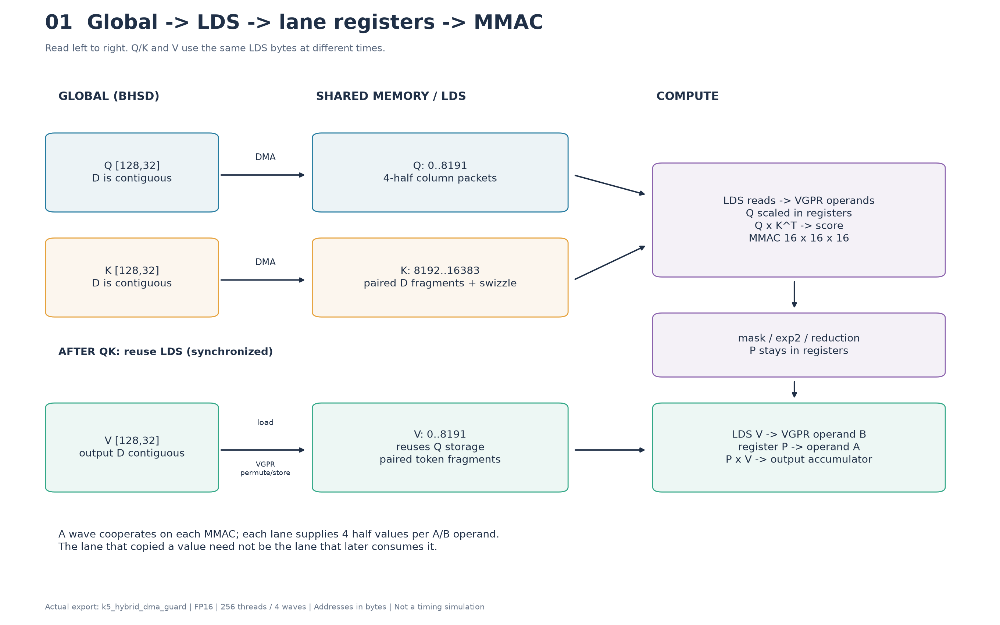
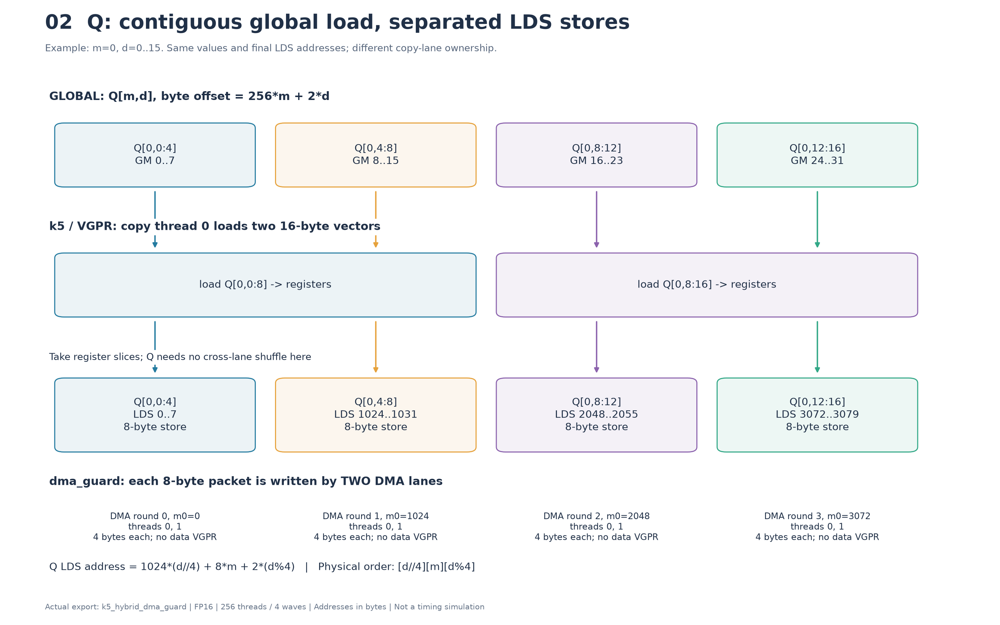
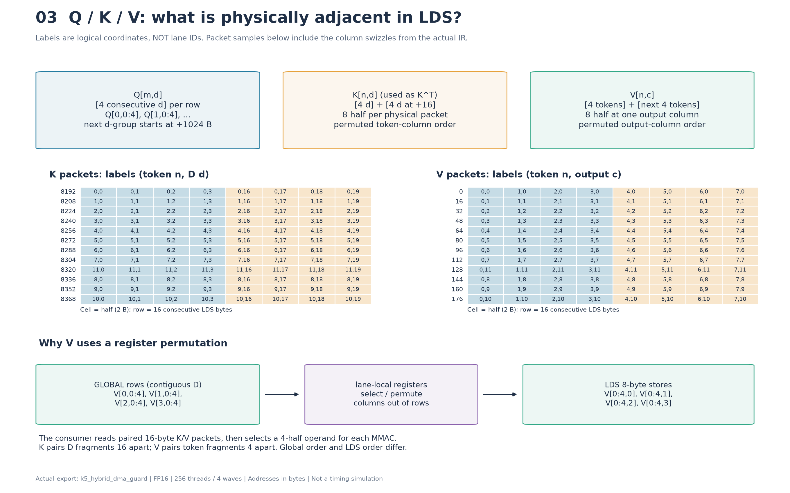
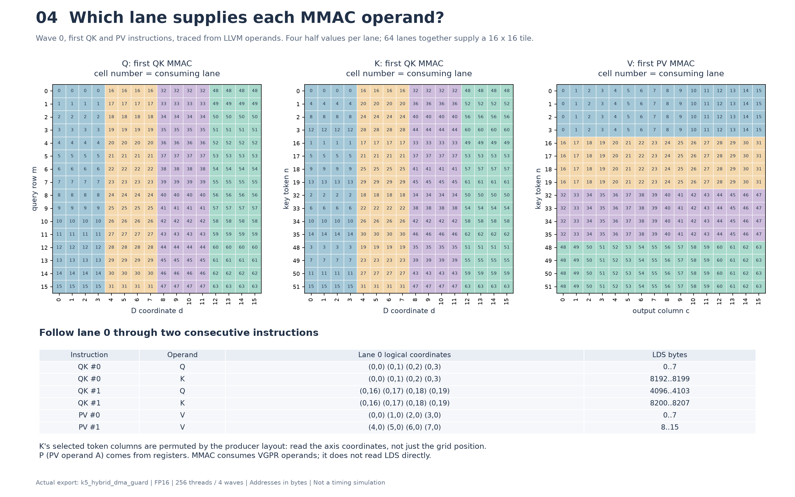

# 当前结果

本文对应 `test_input_spidD_best_k5_hybrid_dma_guard.ll` 与同步搬运的 `k_5`。性能数字来自本次提供的 PMC 日志，地址和指令结构来自 LLVM IR、GCN 汇编及逐元素地址核对；性能归因仍需通过单变量 GPU 实验量化。

术语说明：原始记录中的 “TMA” 在当前实现中具体是 **gfx936 的 global-to-LDS DMA**，汇编为 `global_load_dword ... lds`，不是带张量描述符、可以任意重排的通用张量搬运。当前 **Q/K 使用 DMA，V 仍由 global load → VGPR → LDS store 搬运**。本文沿用项目中的 WMMA/Layout 名称，实际计算指令是 `v_mmac_f32_16x16x16_f16`。

## 1. 性能数据

以下保留原始计数器记录：

```text
// splitD + TMA + wmmaB重排  acc=0.2927
kernel-name:"Attn_p2"
 kernel dispatch index                     19
 gpu id                                    0
 dispatch queue id                         0
 dispatch queue index                      37
 process id                                5642
 thread id                                 5642
 grid size                                 262144
 work group size                           256
 shared memory size                        16384
 scratch size                              0
 vgpr count                                248
 sgpr count                                112
 fbarrier count                            0
 signal handle                             0x0
 kernel time                               0.003831(s)
 processed ALU instructions                36.4841621445(%)
 performance                               4595.494739(Gflops)
 shared memory operation                   6479872
 shared memory bank conflict               0.0000000000(%)
 L1 cache unit is active                   80.5113289488(%)
 L1 cache unit is stalled                  1.1089501937(%)
 L2 cache write unit is stalled            0.0389493824(%)
 L2 cache hit rate                         15.728157(%)


kernel-name:"Attn_p2"  k_5 
 kernel dispatch index                     143
 gpu id                                    0
 dispatch queue id                         0
 dispatch queue index                      261
 process id                                4892
 thread id                                 4892
 grid size                                 262144
 work group size                           256
 shared memory size                        16384
 scratch size                              0
 vgpr count                                248
 sgpr count                                112
 fbarrier count                            0
 signal handle                             0x0
 kernel time                               0.002383(s)
 processed ALU instructions                47.3775838771(%)
 performance                               5660.255226(Gflops)
 shared memory operation                   8101888
 shared memory bank conflict               0.0000000000(%)
 L1 cache unit is active                   59.0456719964(%)
 L1 cache unit is stalled                  1.8503741321(%)
 L2 cache write unit is stalled            0.0526789981(%)
 L2 cache hit rate                         8.088393(%)
```

| 指标 | k_5：同步向量搬运 | hybrid_dma_guard |
|---|---:|---:|
| acc（相对基准的加速比，不是正确率） | 0.46772 | 0.2927 |
| kernel time | 2.383 ms | 3.831 ms |
| VGPR / LDS | 248 / 16 KiB | 248 / 16 KiB |
| scratch / LDS bank conflict | 0 / 0% | 0 / 0% |
| shared memory operation | 8,101,888 | 6,479,872 |
| processed ALU instructions | 47.38% | 36.48% |
| L1 active | 59.05% | 80.51% |
| L2 hit rate | 8.09% | 15.73% |

DMA 版的 SHM operation 减少约 **20.0%**，但耗时增加约 **60.8%**。两版都有 splitD 和 B 布局优化，不能把该差异理解成“加入 WMMA B 重排的收益/损失”；本次主要比较的是搬运路径及其调度变化。

## 2. 当前采用的优化手段
k_5 已采用的优化措施

本节的 k_5 指同步搬运基线，不包括后来新增的 Q/K DMA、DMA 地址保护、grouped waits 或实验性 LDS fragment reuse。

| 优化 | 当前做法与作用 | 代价/边界 |
|---|---|---|
| splitD 分块 | `BM=128, BN=128, BK=32`；QK 沿 D 分四段归约，PV 沿输出 D 分四段计算 | 需要循环/分段地址计算；不同输出段复用 LDS |
| full jam 与共享 QK/P | 合并输出 D 分段，使每个 key tile 的 QK、mask、exp2/分母计算可供四段 PV 共用，避免重复计算 | 同时保留多段 O 累加器，提高寄存器压力 |
| 256 threads、block layout `4,1` | 四个 wave 沿 M 分布，N 方向不跨 wave，便于行归约及 QK→PV 的寄存器衔接 | block layout 本身不保证高 occupancy |
| `b-permute` WMMA layout | 通过跨 N 指令的 B 逻辑列置换，让 QK 输出每 lane 的值形成连续逻辑列片段 | 要同步改变 C 的逻辑映射及后续 PV 的消费映射 |
| P 保持在寄存器 | QK 结果经 mask、exp2、f16 打包后直接作为 PV 的 A 操作数 | 本例的 P 指未最终归一化权重；分母另累加，最终归一化 O；不能概括成所有中间值都不访问 LDS |
| GM 向量搬运与 LDS packing | Q/K 用 `<8 x half>` global load；V 用 `<4 x half>` global load。按消费者布局向量写入/读取 LDS | GM 的连续方向与 LDS 的连续方向可能不同，需要拆包或 permute |
| fragment 级组织与指令重排 | 将片段加载、计算组织在一起，为局部指令交叠创造空间 | 不等同于跨循环 double buffering/software pipeline |
| MMAC accumulator 融合 | 将可融合的 MMAC 后加法接入累加器链，减少独立加法与临时值 | 原始导出日志报告 32 条 accumulator chain 融合 |
| 寄存器生命周期优化 | 压缩线程索引、延后地址计算、缩短地址/exp2 中间值寿命并尽早打包 | 减少长活跃区间可能换来重算，不能只按 VGPR 数判断收益 |
| mask 快路径 | 整块有效时走统一快速路径；边界/对角块保留逐元素 mask | 历史参数中 mask-add 融合关闭，不应与 mask 快路径混为一谈 |
| 数学优化 | 原生 `amdgcn.exp2`，以及共享分母的倒数后乘法；保留数值验证要求 | 日志报告 64 个 native exp2、16 个 reciprocal divisions；这是静态变换计数 |
| 有界 V 预取 | 首段 V 的四个 packet 提前加载，导出日志给出最多 8 个寄存器 word 的预取预算 | 该预算不约束后端总 VGPR；后续三段仍有预取空间 |
| O 直接写回 | 累加结果在寄存器中归一化后写 GM，避免完整 O 的 LDS 中转 | 最终输出布局仍可有寄存器/shuffle 转换 |

dma版本：相比K5 采用了异步拷贝，但每个线程拷贝的数据有所变化


## 2. 性能问题的解释

### 2.1 无 bank conflict、无 spill，不等于延迟已被隐藏

bank conflict=0 只说明该计数器没有报告 LDS bank 冲突；scratch=0 排除了本次记录中的 scratch 开销。它们不能排除 GM 请求发射、地址计算、等待、屏障、低驻留率和 MMAC 指令调度开销。

DMA 省掉了显式 `ds_write`，但仍然向 LDS 写入数据。SHM operation 不是总搬运字节数，也不是执行时间，不能按其下降比例预测加速。L1 active 上升、ALU 指标下降与搬运/等待开销增大相符，但 **L1 active 不是带宽利用率，L2 hit rate 也不是 HBM 流量**；缺少事务、字节数和 stall 明细时，不能断言 HBM 带宽已经饱和。日志中的 Gflops 字段同样不应替代统一口径的工作量/时间比较。

### 2.2 Q/K DMA 的加载粒度更细，而且受 LDS 目的地址约束

旧 k_5 中，每个 Q/K tile 的每线程搬运在 IR 中各有两次 `<8 x half>` global load，即 `2×16 B`；当前各有八条 dword DMA，即 `8×4 B`。前者是 IR 向量加载数量，不能在缺少对应旧汇编时直接称为两条机器指令。

当前 DMA（immediate offset=0）具有以下寻址方式：

```text
GM source(lane)   = 每个 lane 自己的源地址
LDS destination  = m0 + 4 * lane_id
m0               = wave 内统一的 LDS 基址
```

普通 VGPR 路径可独立选择每个 lane 的 GM load 地址和 LDS store 地址，还能拆分/重排寄存器数据。DMA 的 LDS 地址不能按原来 `ds_write` 的每线程任意地址直接指定。因此，当前 lowering 按 **物理 LDS dword 顺序分配搬运 lane，再反推逻辑元素对应的 GM 地址**。这一约束见 [LLVM DMA 语义](https://llvm.org/docs/AMDGPUDMAOperations.html)；本项目实现见 [LowerFriskAsyncCopy.cpp](../3rd/deepgengraph/lib/Conversion/ConvertToLLVM/LowerFriskAsyncCopy.cpp)。

例如 Q 第一轮、wave 0 的前几个 lane：

| DMA lane | GM 字节地址（忽略公共基址） | LDS 字节地址 | 逻辑元素 |
|---|---:|---:|---|
| 0 | 0–3 | 0–3 | Q[0,0:2] |
| 1 | 4–7 | 4–7 | Q[0,2:4] |
| 2 | 256–259 | 8–11 | Q[1,0:2] |
| 3 | 260–263 | 12–15 | Q[1,2:4] |

该 wave 的一条 DMA 有效载荷为 256 B，却覆盖 32 个不同的 128 B 地址段。后续轮次继续从这些行中取不同的 D 分组。这是**静态地址分布**，不是实测内存事务数，更不意味着 HBM 流量按相同比例放大；缓存可能复用。但相较宽加载，更多的 issue、地址计算、`readfirstlane` 和 `m0` 设置都可能抵消省掉 LDS store 的收益。

### 2.3 当前 async 尚未形成跨循环的计算/搬运重叠

当前汇编的 QK 内循环大体是：

```text
8 条 Q DMA
wait vmcnt(0) lgkmcnt(0) + barrier
8 条 K DMA
wait vmcnt(0) lgkmcnt(0) + barrier
QK MMAC
barrier，随后复用 Q/K LDS
```

其中穿插了地址计算和少量 LDS 读取，但没有将下一块 GM 搬运与当前块 MMAC 形成稳定的软件流水。`D/BK=4`，因此每个 key tile 的 QK 阶段执行 12 次 barrier；旧 k_5 对应为 8 次。Q/K 分开等待还减少了两个独立 copy 同时在途的机会。

可以实验“Q、K 都发射后，在首次消费前统一等待和发布”，但必须连同消费读取、LDS 别名及覆盖时序一起调整。旧 grouped 版本含有当时尚未修复的 DMA 地址问题，不能据此否定合并等待；应基于地址保护后的正确版本重新验证。

### 2.4 V 只有第一段提前预取，后面三段仍有明显等待窗口

当前第一段 V 的四条 `global_load_dwordx2` 提前发射，后面有 exp2/归约等计算可以覆盖延迟。第二、三、四段则基本为：

```text
barrier → V global load → 很快 wait → permute → LDS store → barrier → PV
```

因此可以先试“当前 PV 段计算期间，将下一段 V 预取到 VGPR；当前 LDS 读取结束后再写入复用空间”。它不一定需要 LDS 双缓冲，但会增加临时 VGPR 活跃量，必须观察是否重新产生 spill。

直接给 V 加 DMA 需要满足其转置式、配对式 LDS 布局。旧全 async 路径曾引入 staging/repack，使 LDS 增至 24 KiB、scratch=96、bank conflict≈4.22%、耗时 5.105 ms；这说明**那条实现路径**代价过高，不能推导为“所有 V DMA 都无效”。

### 2.5 248 VGPR 仍可能限制隐藏延迟的能力

当前汇编资源信息为 `NumVgprs: 248`、`ScratchSize: 0`、`Occupancy: 1`。最后一项是编译器资源估计，不是硬件实测 active wave 数，且不能直接解释为“每 CU 一个 block”。不能仅依据 16 KiB LDS 就断言每 CU 能驻留四个 block，还需要考虑寄存器及目标硬件限制。

k_5 同样使用 248 VGPR，所以寄存器数量本身不是本次退化的独立解释；但资源紧张会使新增的等待更难被其他 wave 隐藏。当前 MMAC inline asm 还包含前后 `s_nop 1`，属于后续调度分析对象；在缺少 gfx936 hazard 依据时，不应直接删除。


历史测试记录如下，反映当时的逐步调优过程，不能视为各项收益可直接相加的严格消融实验：

| 版本 | 主要变化 | acc |
|---|---|---:|
| k_1 | 地址优化 | 0.26769 |
| k_2 | full jam | 0.41907 |
| k_3 | mask 快路径 | 0.42470 |
| k_4a | native exp2 分支 | 0.45953 |
| k_4b | 倒数归一化分支 | 0.42665 |
| k_4c | 数学优化合并 | 0.46122 |
| k_5 | 在 k_4c 基础上增加 V 预取 | 0.46772 |

其中 k_5 相对 k_4c 的 acc 提升约 1.41%，说明当时的首段 V 预取收益有限。依据见 [优化记录](../优化记录.md) 和 [k_5 导出日志](../generated_ir/test_input_spidD_best_k5.log)末尾的优化计数。

## 4. WMMA Layout 与跨 WMMA 的 B 数据重排

### 4.1 区分三种不同的布局

| 层次 | 决定什么 | 本例 |
|---|---|---|
| GM tensor layout | 逻辑元素在 global 的地址 | 运行器 ABI 为 BHSD，D 连续；固定 head 时相邻 token 相差 `128×2=256 B` |
| WMMA/register layout | 某条指令中，每个 lane 的每个寄存器元素对应哪个逻辑坐标 | wave64 的 A/B 各四个 half，C 四个 float；加上跨指令的逻辑变换 |
| LDS physical layout | 逻辑元素在 shared memory 的字节地址 | Q 四元素分组，K/V 配对打包及列置换 |

WMMA/MMAC 消费的是 **VGPR 操作数**，不是直接从 LDS 取矩阵。编译器根据寄存器布局安排 LDS load，再把获得的寄存器片段送给 MMAC。搬运 lane 与消费 lane 可以不同，LDS 是两者之间的交接位置。

### 4.2 单条 wave64 MMAC 的原生坐标关系

记 `l=lane_id∈[0,63]`、`r∈[0,3]`，忽略外层 tile 原点。在项目使用的 `16×16×16` 指令模型中：

```text
A 第 r 个 half：A[l%16, 4*(l//16)+r]
B 第 r 个 half：B[4*(l//16)+r, l%16]
C 第 r 个 float：C[l%16, l//16+4*r]
```

例如 lane 0 的原生 C 是同一行的列 `0,4,8,12`，而后续 GEMM 的 A 通常需要同一 lane 提供连续归约坐标。直接衔接会遇到 C→A ownership 不一致，需要布局转换。可选办法包括 LDS 中转、wave 内 shuffle，或改变前一个 GEMM 的 B 取数顺序。这里采用第三种 `b-permute`。上述坐标契约和变换一致性由 [check_wmma_b_permute.py](../3rd/deepgengraph/test/check_wmma_b_permute.py) 的 CPU 模型验证。

### 4.3 跨四条 N 方向 WMMA 的逻辑列置换

它不是改变 MMAC 硬件语义，而是为硬件列坐标重新分配逻辑 token。每 64 列为一组，组内硬件列 `x` 分解为：

```text
x = 16*q + 4*r + t      q,r,t ∈ [0,3]
logical_column = 16*t + 4*q + r
```

其中 `q` 表示 N 方向的第几条 16 列指令。对应完整列映射为：

```text
pi(x) = 64*(x//64) + 16*(x%4) + 4*((x//16)%4) + (x//4)%4
```

第一条指令的 B 硬件列 `0..15` 对应逻辑列：

```text
0,16,32,48, 1,17,33,49, 2,18,34,50, 3,19,35,51
```

于是 lane 0 的 C 原生列 `0,4,8,12` 被解释为逻辑列 `0,1,2,3`。下一条 N 方向指令使该 lane 得到逻辑列 `4,5,6,7`，四条 N 指令合起来覆盖其连续的 16 个逻辑列。这里的“四条 N 指令”不等同于汇编中四条连续 MMAC，因为实际还穿插 QK 归约维上的指令。

相同的双射同时作用于 B 和 C，Q/A 及 QK 的 D 归约不变。实现见 [WmmaLayout.h](../3rd/deepgengraph/include/deepgengraph/Analysis/WmmaLayout.h)。这样 QK 产生的寄存器权重片段更适合直接交给 PV；**PV 的 A 和 V/B 必须采用一致的逻辑 token 归约顺序**，不能只重排 K 后仍沿用未经转换的 PV 映射。

例如 wave 0 的第一条 PV，lane 0 消费 `V[0:4,0]`，lane 16 消费 `V[16:20,0]`，lane 32 消费 `V[32:36,0]`，lane 48 消费 `V[48:52,0]`。单条指令涉及的逻辑 token 可以不连续，但其 P/V 配对和各条指令合起来的归约必须完整。

### 4.4 对 LDS 的影响：逻辑 B 重排与物理打包是两层变换

`b-permute` 首先改变“哪些逻辑元素由哪些 lane、哪些 MMAC 指令消费”，它本身并不唯一规定 LDS 地址，也不要求先生成一份重排过的 GM tensor。编译器可以将它落实到源地址/读取地址中。

本例再根据消费者布局做 LDS packing：将同一 lane 后续两条指令需要的四 half 片段配成连续八 half，使用 16 B 向量读取；同时对包所在列做置换，协调生产端 store 与消费端 load 的 bank 分布。因此需要区分：

1. **跨 N 指令的 B 逻辑列置换**：目的是改变 QK 输出 ownership，让 P 尽量保留在寄存器中。
2. **跨归约片段的 LDS 配对**：目的是将两个 8 B 操作数片段合成一次 16 B 读取；本例 K 的配对间隔为 16 个 D 元素，V 为 4 个 token。
3. **LDS 列置换**：改变物理包次序，降低实际 lane 访问中的 bank 冲突；不是再次改变数学矩阵。

三者相互关联，但不能统一描述为“K 在 LDS 中简单转置成 BN×BK”。

## 5. 当前 Q/K/V 的精确 LDS 布局

设 tile 内 `m` 为 query 行，`n` 为 key token，`d` 为 QK 的 D 分段坐标，`c` 为 PV 的输出 D 分段坐标。`m,n∈[0,127]`，`d,c∈[0,31]`。半开区间 `0:4` 表示四个元素 `0,1,2,3`。

| tile | 计算中的逻辑形状 | LDS 区域与复用 |
|---|---|---|
| Q | `[BM,BK]=[128,32]` half | `[0,8192)` |
| Kᵀ | `[BK,BN]=[32,128]` half；下文仍用 GM 视角 `K[n,d]` 标记元素 | `[8192,16384)` |
| V | `[BN,BK]=[128,32]` half | PV 阶段复用 `[0,8192)`，四个输出 D 段依次使用 |

V 的第一维是 **BN**，不是 BM；此处两者都等于 128，数值相同但语义不同。P 没有完整 tile 的 LDS 中转。

### 5.1 Q：按四 half 的 D 片段存放

物理上可视为 `[D/4][M][4]=[8][128][4]`，字节地址为：

```text
addr_Q(m,d) = 1024*(d//4) + 8*m + 2*(d%4)
```

```text
LDS 0..7       Q[0,0:4]
LDS 8..15      Q[1,0:4]
...
LDS 1016..1023 Q[127,0:4]
LDS 1024..1031 Q[0,4:8]
...
```

旧 k_5 的 lane 0 连续加载 `Q[0,0:8]` 和 `Q[0,8:16]`，再以四 half 为单位写到 `0、1024、2048、3072`。这里 Q 的 `shufflevector` 主要是选择已有寄存器的片段，不表示必须进行跨 lane shuffle。当前 DMA 为保持同样的目的内容，改由 lane 0、1 各写一半，每轮更新 m0。

这种布局使计算端访问相邻行的四 half 片段时，地址间隔为 8 B，而不是普通紧凑 `[128,32]` 行主序的 64 B。按项目采用的 32 bank、4 B/bank 模型，它更适合当前读取分组；但精确冲突仍须按指令的 lane phase 检查。一般方法见 [AMD LDS bank conflict 说明](https://rocm.blogs.amd.com/software-tools-optimization/lds-bank-conflict/README.html)。

### 5.2 K：D 片段配对，再置换 token 列

最前面的两个连续 16 B 包为：

```text
LDS 8192..8199：K[0, 0:4]
LDS 8200..8207：K[0,16:20]
LDS 8208..8215：K[1, 0:4]
LDS 8216..8223：K[1,16:20]
```

所以这里只能说“四 half 内 D 连续”，不能说完整的 32 个 D 按普通行主序连续存放。当前参数为 `shared_pack=4, axis=0, pair_stride=16`。精确地址（字节）为：

```text
g  = (d%16)//4
cg = n//8
np = 8*cg + 4*((n//4 + cg//4 + g//2)%2) + (n+cg)%4
addr_K(n,d) = 8192 + 2*((g*128 + np)*8 + 4*(d//16) + d%4)
```

`np` 是存储包的 token 列置换。例如第一组物理包中的 token 顺序开头是 `0,1,2,3,4,5,6,7,11,8,9,10,...`。它与上一节 `pi` 的“跨 WMMA 逻辑列置换”不是同一个映射。

### 5.3 V：沿 token 维配对，GM 加载方向与 LDS 包方向不同

当前参数为 `shared_pack=4, axis=0, pair_stride=4`，最前面的两个 16 B 包为：

```text
LDS  0..7 ：V[0:4,0]
LDS  8..15：V[4:8,0]
LDS 16..23：V[0:4,1]
LDS 24..31：V[4:8,1]
```

精确地址（字节）为：

```text
g  = n//8
cg = c//8
cp = 8*cg + 4*((c//4 + cg//4 + g)%2) + (c+cg)%4
addr_V(n,c) = 2*((g*32 + cp)*8 + 4*((n//4)%2) + n%4)
```

GM 的连续方向是同一 token 的不同 D 列；V 的一个 LDS 包却沿 token 维收集同一输出列。因此 VGPR 路径先向量加载多行，再通过 lane 内 `permute` 组合成按列的片段后写入。这解释了为什么 V 不能直接把原来的向量 load/store 一对一替换成当前 dword DMA。

这三组公式来自 [PackSharedMemory.cpp](../3rd/deepgengraph/lib/Conversion/FriskToBase/PackSharedMemory.cpp) 的打包规则，并与当前 IR 的元素地址交叉验证：Q/K 各 4096 个元素，四段 V 各 4096 个元素，总计 24,576 个；与同步 k_5 的 LDS 目的地址一致。该核对使用 head/block/key/D 起始上下文，不代替硬件时序或性能验证。

## 6. 后续优化的实验顺序

| 优先级 | 实验 | 要回答的问题 |
|---|---|---|
| 1 | 地址保护后的 Q/K 合并 issue/wait | 退化中有多少来自分开等待和多一次 barrier？ |
| 2 | 仅 Q DMA、仅 K DMA、Q/K 都用同步向量搬运 | 哪个 tile 的细粒度请求/地址布局代价更大？ |
| 3 | V 后三段的有界寄存器预取 | 能否用当前 PV 计算覆盖下一段 V 的加载，且不 spill？ |
| 4 | 联合调整 copy ownership、LDS packing 和 MMAC 读取映射 | 能否同时改善 GM 合并访问并保持 LDS 无冲突？ |
| 5 | 再评估 V direct DMA 或双缓冲 | 在正确布局和资源预算下，是否获得实际 overlap？ |

每次保持 shape、数学模式、grid/block 和基准一致，先正确性检查，再记录时间、VGPR、scratch、LDS 与相关计数器。保留当前 DMA 地址保护；它修复的是源立即数折叠同时影响 LDS 地址的问题，不应通过移除保护换取表面性能。旧 hybrid 的 3.799 ms 与当前 guard 的 3.831 ms 接近，但旧版数值错误，不能当作有效的正确性能基线。

## 7. 配图与复现

按“整体数据流 → Q 拷贝 → K/V 物理包 → 消费 lane”的顺序阅读：









图中逻辑坐标、LDS 地址、copy thread 和 consuming lane 需要分别看待。例如 `Q[0,4:8]` 在旧路径由 copy thread 0 搬运，在 DMA 路径由 thread 0、1 搬运，随后由计算 lane 16 消费。

文件：[四页 PDF](../generated_ir/layout_visualization/attention_lds_explained.pdf)、[中文阅读说明](../generated_ir/layout_visualization/阅读说明.txt)、[拷贝映射 CSV](../generated_ir/layout_visualization/copy_mapping.csv)、[MMAC 操作数 CSV](../generated_ir/layout_visualization/mmac_operands.csv)、[地址验证记录](../generated_ir/layout_visualization/validation.json)。

在仓库根目录重新生成：

```bash
python3 script/plot_attention_lds.py
```

原始证据：[PMC 日志](../pmc_test.log)、[GCN 汇编](../k_test.gcn.log)、[同步 k_5 IR](../generated_ir/test_input_spidD_best_k5.ll)、[DMA guard IR](../generated_ir/test_input_spidD_best_k5_hybrid_dma_guard.ll)。两份 `.log` 原文件为 UTF-16；汇编资源信息及上述地址关系对应当前上传的版本。
